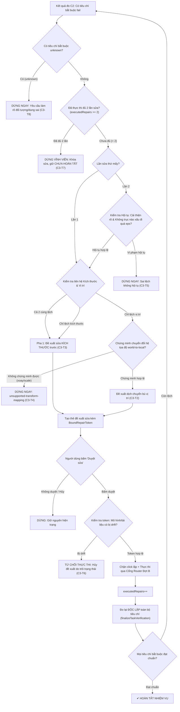

# TASK-40 Đợt C3 — Phương án sửa sai theo sai lệch đo được và Ma trận kiểm thử (Bản trình duyệt Reviewer)

Nền tảng kỹ thuật đã nghiệm thu:
- **C1/C1.1/C1.2/C1.3** (`9f6beda9`, nghiệm thu metadata `70e41818`): Định danh tiêu chí, cấu trúc ba trạng thái (`pass`/`fail`/`unknown`), Runner kiểm tra hình học.
- **C2** (`7e659dff`, SHA đầy đủ: `7e659dff1300ae012a45b7df072ffd4c0ef73000`):
  - Phân tách tài liệu được đo khỏi tài liệu đang mở; đối chiếu tài liệu sau đo; dừng và hủy kết quả cũ khi đổi tài liệu hoặc phát hiện trôi trạng thái hình học/nhiệm vụ.
  - Đã triển khai đồng bộ lên VPS (`http://136.66.95.155`), hai endpoint `version.json` và `deploy-version.json` khớp SHA.
  - Nghiệm thu tự động qua ChatPanel kịch bản S1–S5 trên kernel OCCT thật đạt 5/5 (`c2_run_flow.mjs`).

> [!IMPORTANT]
> **VỊ THẾ TÀI LIỆU**: Đây là bản đặc tả kỹ thuật và ma trận kiểm chứng hoàn chỉnh của Đợt C3 trình Reviewer phê duyệt.
> **CAM KẾT TUÂN THỦ**: Vòng này **CHƯA VIẾT CODE C3**, **CHƯA CẤP QUYỀN GHI MỚI**, và **CHƯA TRIỂN KHAI VPS**. Toàn bộ mã nguồn C3 sẽ chỉ được triển khai sau khi Reviewer phê duyệt tài liệu này.

---

## 1. Giới hạn sửa kích thước tự động & Chuyển đổi hệ tọa độ

### 1.1. Phạm vi hỗ trợ sửa kích thước (Parameter-to-Measurement-Axis Mapping)
Phép đo của Runner Đợt C2 dựa trên hộp bao trục tọa độ thế giới (world-axis bounding box). Việc suy ngược từ sai lệch đo được ($\Delta X, \Delta Y, \Delta Z$) sang tham số của đối tượng CAD chỉ được phép thực hiện khi thỏa mãn đồng thời hai điều kiện:
1. **Quan hệ 1:1 giải tích đã kiểm chứng giữa tham số và trục đo**:
   - Đối tượng thuộc loại khối cơ sở trực giao (axis-aligned primitive), cụ thể là `BoxNode` có các cạnh song song với trục tọa độ.
   - Ánh xạ rõ ràng: tham số `dx` tương ứng trục X, `dy` tương ứng trục Y, `dz` tương ứng trục Z.
   - Đối với các khối hình phức tạp (như B-rep tự do, sketch loft, sweep, boolean tổng hợp, hoặc khối có vát mép/bo tròn ảnh hưởng trực tiếp đến kích thước bao ngoài): **Hệ thống KHÔNG tự động sửa tham số kích thước**.
2. **Xác định chính xác điểm neo hình học (Anchor Point)**:
   - Cần xác định điểm chuẩn mà từ đó kích thước mở rộng. Ví dụ: `BoxNode` có điểm neo mặc định tại góc cực tiểu $(x_{\min}, y_{\min}, z_{\min})$.
   - Khi biết điểm neo, hệ thống mới tính toán được chính xác sự dịch chuyển tương hỗ của tâm hình học khi kích thước thay đổi.

### 1.2. Phép dịch và Bằng chứng chuyển đổi hệ tọa độ (Coordinate Transform Proof)
- Runner đo lường trên hệ tọa độ thế giới (World Coordinate System: `coordRef: "world"`).
- Lệnh dịch chuyển (`transform_node` hoặc cập nhật tọa độ gốc) nhận vector tham số trong hệ tọa độ cục bộ (Local Frame) hoặc hệ tọa độ của đối tượng cha (Parent Frame).
- **Quy tắc chứng minh chuyển đổi**:
  - Đối với đối tượng nằm trực tiếp dưới root và không có xoay/scale: $\vec{T}_{\text{local}} = \vec{T}_{\text{world}}$. Vector dịch bù giải tích là $\vec{T}_{\text{bù}} = [-\Delta X, -\Delta Y, -\Delta Z]$.
  - **Điều kiện dừng an toàn**: Nếu đối tượng hoặc bất kỳ đối tượng cha nào trong cây phả hệ (parent hierarchy) có:
    1. Góc xoay (rotation) khác 0 hoặc phi trực giao;
    2. Tỉ lệ co giãn (scaling) phi đồng nhất (non-uniform scale);
    3. Biến đổi ma trận phân cấp phức tạp chưa được chứng minh giải tích ngược một cách tất định;
    $\implies$ **DỪNG NGAY LẬP TỨC**. Không tạo lệnh dịch chuyển mò. Báo lý do rõ ràng trên thẻ:
    `unsupported-transform-mapping: đối tượng có phép xoay/scale/transform cha phức tạp chưa chứng minh được chuyển đổi tọa độ world-to-local`.

---

## 2. Xử lý kích thước và vị trí có liên hệ (Coupled Size & Position Sequencing)

### 2.1. Bản chất tương hỗ giữa Kích thước và Vị trí tâm
Trong không gian 3D, khi thay đổi kích thước của một khối được neo tại một đầu (hoặc góc cực tiểu), tâm hình học của khối đó sẽ tự động dịch chuyển:
$$\Delta \text{Center}_X = \frac{\Delta \text{dx}}{2}, \quad \Delta \text{Center}_Y = \frac{\Delta \text{dy}}{2}, \quad \Delta \text{Center}_Z = \frac{\Delta \text{dz}}{2}$$

Nếu một thuật toán ngây thơ đồng thời phát lệnh sửa kích thước $+100\text{ mm}$ VÀ phát lệnh dịch chuyển bù tâm $+50\text{ mm}$ dựa trên số đo ban đầu, thì sau khi kích thước dời tâm $+50\text{ mm}$, lệnh dịch chuyển sẽ đẩy tâm thêm $+50\text{ mm}$ nữa $\implies$ tổng dịch chuyển tâm thành $+100\text{ mm}$, dẫn đến hiện tượng **quá đà (overshoot)** và phá vỡ dung sai vị trí.

### 2.2. Chiến lược phân pha bắt buộc (Strict Phased Repair)
Để loại bỏ hiện tượng quá đà, hệ thống áp dụng quy tắc tuần tự hóa:
1. **Pha 1 (Ưu tiên Kích thước — Size-First)**:
   - Nếu cả kích thước và vị trí đều lệch (hoặc chỉ kích thước lệch): **Chỉ đề xuất sửa kích thước**.
   - Tuyệt đối không đề xuất lệnh dịch chuyển vị trí trong pha này.
2. **Pha trung gian (Đo lại độc lập toàn bộ tiêu chí)**:
   - Sau khi lệnh sửa kích thước được duyệt và thực thi, kích hoạt `finalizeTaskVerification` đo lại **toàn bộ tiêu chí** (cả kích thước lẫn vị trí).
3. **Pha 2 (Đề xuất Dịch chuyển nếu vẫn lệch — Position Follow-up)**:
   - Chỉ khi kích thước đã đạt chuẩn (hoặc không lệch) mà vị trí tâm đo mới **vẫn nằm ngoài dung sai đã duyệt**, hệ thống mới đề xuất lệnh dịch chuyển bù sai lệch vị trí còn lại.

### 2.3. Ca hồi quy chuẩn (Box Regression Case: 700 → 800 mm)
- **Hiện trạng ban đầu**: Hộp `BoxNode` neo tại gốc $X=0$, chiều dài $dx=700\text{ mm}$, tâm hiện tại $X=350\text{ mm}$.
- **Tiêu chí bắt buộc đã duyệt**:
  - Tiêu chí kích thước: $dx = 800\text{ mm}$ (dung sai $\pm 2\text{ mm}$).
  - Tiêu chí vị trí: Tâm $X = 400\text{ mm}$ (dung sai $\pm 2\text{ mm}$).
- **Lần đo 1**:
  - Đo kích thước: $700\text{ mm}$, lệch $-100\text{ mm}$ (`fail`).
  - Đo vị trí: $350\text{ mm}$, lệch $-50\text{ mm}$ (`fail`).
- **Hành vi xử lý**:
  - Hệ thống nhận diện kích thước và vị trí cùng lệch trên trục X. Áp dụng quy tắc Phased Repair: **Chỉ đề xuất sửa kích thước `dx: 700 → 800 mm`**.
  - Người dùng duyệt đề xuất Pha 1. Lệnh cập nhật `dx = 800 mm` thực thi thành công.
  - Runner đo lại toàn bộ tiêu chí:
    - Kích thước đo được: $800\text{ mm}$ $\implies$ delta = $0\text{ mm} \le 2\text{ mm}$ (`pass`).
    - Vị trí tâm đo được: $400\text{ mm}$ (do neo $X=0$, dài $800\text{ mm}$ nên tâm tự đổi thành $400\text{ mm}$) $\implies$ delta = $0\text{ mm} \le 2\text{ mm}$ (`pass`).
- **Kỳ vọng nghiệm thu**: **Không phát sinh bất kỳ lệnh dịch chuyển thừa nào**. Cả 2 tiêu chí đều chuyển sang `pass` và hệ thống hiển thị `✔ HOÀN TẤT` ngay sau Pha 1.

---

## 3. Đánh giá tiến triển theo từng tiêu chí & trục với dung sai đã duyệt

### 3.1. Sai lệch thành phần theo tiêu chí và trục
Với mỗi tiêu chí $c \in \text{Criteria}$ và từng trục không gian $a \in \{X, Y, Z\}$:
$$\Delta_{c, a}^{(k)} = |\text{measured}_{c, a}^{(k)} - \text{expected}_{c, a}|$$
Trong đó $k \in \{0, 1, 2\}$ là chỉ số lần đo (0: trước khi sửa; 1: sau sửa lần 1; 2: sau sửa lần 2).

### 3.2. Định nghĩa Ngưỡng nhiễu ($\epsilon_{\text{noise}}$) và Hành vi khi Dung sai bằng 0
Trong tính toán đồ họa CAD (meshing, B-rep query, floating-point bounding box), luôn tồn tại sai số rời rạc hóa số học.
- **Định nghĩa ngưỡng nhiễu**:
  $$\epsilon_{\text{noise}} = \min(0.05\text{ mm}, 0.05 \times \text{tolerance}_{c, a})$$
- **Hành vi khi dung sai bằng 0 ($\text{tolerance}_{c, a} = 0$)**:
  - Trong kỹ thuật CAD thực tế, yêu cầu dung sai bằng 0 được hiểu là kiểm tra tính chính xác hạt nhân số học.
  - Ngưỡng nhiễu khi dung sai bằng 0 được gán giá trị ngưỡng tính toán hạt nhân:
    $$\epsilon_{\text{noise}} = 1 \times 10^{-4}\text{ mm} \quad (0.1\,\mu\text{m})$$
  - Mọi biến thiên sai lệch nằm trong khoảng $[-\epsilon_{\text{noise}}, +\epsilon_{\text{noise}}]$ được coi là nhiễu số học thuần túy, không được xem là cải thiện hay suy giảm.

### 3.3. Điều kiện nghiêm ngặt cho phép đề xuất sửa lần 2 (Attempt 2 Gate)
Sau khi thực hiện lần sửa 1, hệ thống đo lại toàn diện. Đề xuất sửa lần 2 **chỉ được phép kích hoạt** khi và chỉ khi thỏa mãn đồng thời 4 điều kiện hội tụ:
1. **Cải thiện rõ rệt (Significant Improvement)**: Có ít nhất một sai lệch bắt buộc giảm rõ rệt vượt qua ngưỡng nhiễu:
   $$\exists c \in \text{Required}, a \in \{X, Y, Z\}: \Delta_{c, a}^{(1)} < \Delta_{c, a}^{(0)} - \epsilon_{\text{noise}}$$
2. **Không có sai lệch bắt buộc nào xấu đi quá ngưỡng nhiễu (No Degradation)**:
   $$\forall c \in \text{Required}, a \in \{X, Y, Z\}: \Delta_{c, a}^{(1)} \le \Delta_{c, a}^{(0)} + \epsilon_{\text{noise}}$$
   *(Nếu một trục tốt lên nhưng trục khác xấu đi vượt quá $\epsilon_{\text{noise}}$, điều kiện này bị vi phạm ngay lập tức)*.
3. **Không phát sinh lỗi mới (No New Failures)**:
   - Số lượng tiêu chí `fail` không tăng lên.
   - Bất kỳ tiêu chí nào đã `pass` ở lần 0 thì bắt buộc phải giữ nguyên `pass` ở lần 1.
4. **Không có tiêu chí bắt buộc nào ở trạng thái `unknown`**:
   - Toàn bộ tiêu chí bắt buộc phải có số đo hình học xác định hợp lệ.

> [!CAUTION]
> **QUY TẮC DỪNG KHÔNG TIẾN TRIỂN**:
> Nếu vi phạm bất kỳ điều kiện nào trong 4 điều kiện trên (ví dụ: trục X giảm lệch nhưng trục Y lệch thêm $5\text{ mm}$, hoặc xuất hiện trạng thái `unknown`): **HỆ THỐNG DỪNG NGAY LẬP TỨC**. Không tạo đề xuất sửa lần 2. Báo lý do:
> `"non-converging-repair: sửa đổi không làm giảm sai lệch toàn diện hoặc làm xấu đi trục khác — dừng vòng tự động để bảo toàn mô hình"`.

### 3.4. Bảo toàn bộ tiêu chí (Criteria Immutability)
- Toàn bộ mảng `criteria` (gồm `id`, `kind`, `expected`, `toleranceMm`, `required`, `unit`) được giữ nguyên 100% không đổi qua các lần sửa.
- Tuyệt đối cấm nới rộng dung sai hoặc bỏ qua tiêu chí khó đo.
- Mọi tiêu chí được đo lại đồng thời sau mỗi lần can thiệp.

---

## 4. Ràng buộc nút “Duyệt sửa” và Cổng bảo vệ nguồn Đợt B

### 4.1. Token ràng buộc toàn vẹn của nút “Duyệt sửa” (`boundRepairToken`)
Để ngăn chặn hoàn toàn việc người dùng duyệt một đề xuất đã cũ hoặc không còn khớp với trạng thái mô hình thực tế, thẻ đề xuất sửa mang một token ràng buộc:
```ts
export interface BoundRepairToken {
    taskId: string;
    documentId: string;
    historyMark: string;            // Undo/redo marker tại thời điểm đo
    rulesFingerprint: string;       // Phiên bản bộ quy tắc thiết kế có hiệu lực
    stateSignature: string;         // World-bbox + volume hash của các subject node
    subjectNodeIds: string[];       // Danh sách ID đối tượng bị tác động
    targetParameters: Record<string, unknown>; // Tham số sửa hiển thị trên thẻ
    attemptIndex: number;           // Lần sửa thứ mấy (1 hoặc 2)
}
```

### 4.2. Xử lý Trôi trạng thái (State Drift Invalidation)
Trước khi thực thi lệnh sửa khi người dùng bấm nút:
1. Hệ thống kiểm tra đối chiếu trạng thái hiện thời của `activeDocument`:
   - `activeDocument.id === token.documentId`
   - `historyMarkOf(activeDocument) === token.historyMark`
   - `rulesFingerprintFor(activeDocument.id) === token.rulesFingerprint`
   - `subjectsSignatureOf(activeDocument, token.subjectNodeIds) === token.stateSignature`
2. **Nếu có bất kỳ sự sai lệch nào** (do người dùng thao tác vẽ thêm, dịch chuyển đối tượng, undo/redo, hoặc đổi tài liệu trong lúc thẻ đang chờ duyệt):
   $\implies$ Token bị coi là **STALE / EXPIRED**.
   $\implies$ Thao tác duyệt bị từ chối ngay lập tức với mã lỗi:
   `"proposal-invalidated-by-drift: mô hình hoặc tài liệu đã thay đổi trong lúc chờ duyệt — đề xuất cũ bị hủy"`.
   $\implies$ Thẻ sửa chuyển sang trạng thái vô hiệu hóa (`stale`), yêu cầu kích hoạt lại lượt đo mới.

### 4.3. Chặn bấm duyệt lặp (Anti-Double-Click / Race Condition Protection)
- Nút "Duyệt sửa" trên giao diện ChatPanel được gán listener với cờ `{ once: true }`.
- Ngay tại millisecond đầu tiên khi nhận sự kiện click:
  - Nút chuyển sang trạng thái `disabled = true` và hiển thị spinner.
  - Cờ `isRepairExecuting = true` được kích hoạt trên phiên làm việc, từ chối mọi sự kiện click phụ.
- Đảm bảo chỉ có đúng một Transaction duy nhất được khởi tạo và gửi tới Cổng điều phối Đợt B.

### 4.4. Giới hạn cứng 2 lần sửa đã thực thi (Strict Lifetime Quota)
- Hệ thống đếm chính xác số lần sửa **đã thực thi thành công vào document** trên cùng tác vụ gốc:
  `rootTask.executedRepairs` (khởi tạo bằng 0, trần cứng bằng 2).
- Các trường hợp đề xuất bị hủy do drift hoặc người dùng bấm "Từ chối" không làm tăng bộ đếm này.
- Khi `executedRepairs === 2`:
  - Hệ thống **khóa vĩnh viễn** khả năng sinh đề xuất sửa cho tác vụ đó.
  - Kể cả khi người dùng chat lại hay yêu cầu tiếp tục, hệ thống từ chối lập đề xuất sửa lần 3.
  - Giữ nguyên thẻ bằng chứng với các dòng `❌` / `❓`, badge `⏳ CHƯA HOÀN TẤT` và dừng vòng lặp tự động để bàn giao cho người dùng thao tác trực tiếp trên giao diện CAD.

### 4.5. Kiểm soát qua Cổng Router Đợt B (Scope Containment)
- Toàn bộ lệnh sửa (sửa tham số `BoxNode` hoặc phát `transform_node`) đều phải đi qua `governedRouter`.
- Phạm vi tác động bị khóa chặt trong `allowedModifiedNodeIds` đã được cấp phép ban đầu của tác vụ.
- Nếu lệnh sửa vô tình hay cố ý chạm vào node ngoài danh mục được phép, Router Đợt B chặn đứng lệnh và rollback trạng thái ngay lập tức.

---

## 5. Ma trận kiểm chứng nghiệm thu mở rộng Đợt C3

| Mã ca | Tên kịch bản | Mô tả tình huống thử nghiệm | Kết quả kỳ vọng chi tiết |
|:---|:---|:---|:---|
| **C3-T1** | Sửa kích thước trực giao đạt chuẩn | Box lệch trục X: đo 700 mm, mong 800 mm (dung sai 2 mm). | Đo lần 1 lệch -100 mm $\implies$ Đề xuất sửa `dx: 700 → 800 mm` $\implies$ Người dùng duyệt $\implies$ Đo lại pass $\implies$ Lật badge `✔ HOÀN TẤT` (tổng 1 lần sửa). |
| **C3-T2** | Sửa vị trí tịnh tiến đạt chuẩn | Box đúng kích thước nhưng lệch vị trí trục Y: đo 400 mm, mong 0 mm (dung sai 2 mm). | Đo lần 1 lệch +400 mm $\implies$ Đề xuất dịch `[0, -400, 0]` $\implies$ Người dùng duyệt $\implies$ Đo lại pass $\implies$ Lật badge `✔ HOÀN TẤT` (tổng 1 lần sửa). |
| **C3-T3** | Hộp đổi kích thước tự dời tâm (Regression) | Box neo tại $X=0$, $dx=700\text{ mm}$ (tâm 350 mm). Tiêu chí yêu cầu $dx=800\text{ mm}$ và tâm $X=400\text{ mm}$. | Pha 1 chỉ đề xuất sửa `dx: 700 → 800 mm` (không sinh lệnh dịch). Duyệt xong đo lại: $dx=800\text{ mm}$ (pass), tâm tự dời về $400\text{ mm}$ (pass). **Không phát sinh lệnh dịch thừa**. Hoàn tất sau 1 lần sửa. |
| **C3-T4** | Dừng khi hệ tọa độ không hỗ trợ | Đối tượng có góc xoay phi trực giao (xoay 45° quanh Z) hoặc scale phi đồng nhất, lệch vị trí. | Nhận diện không chứng minh được ma trận chuyển đổi world-to-local $\implies$ **DỪNG NGAY**, không phát lệnh dịch mù, thông báo `unsupported-transform-mapping`. |
| **C3-T5** | Dừng khi một trục tốt lên nhưng trục khác xấu đi | Sửa lần 1: trục X giảm lệch từ 100 mm xuống 10 mm, nhưng trục Y bị kéo lệch từ 2 mm lên 25 mm ($> \epsilon_{\text{noise}}$). | Kiểm tra hội tụ thấy vi phạm điều kiện No Degradation $\implies$ **DỪNG NGAY**, từ chối đề xuất lần 2, giữ badge `⏳ CHƯA HOÀN TẤT` kèm bảng đối chiếu sai lệch. |
| **C3-T6** | Hủy đề xuất khi mô hình trôi (State Drift) | Thẻ đề xuất sửa đang hiển thị chờ duyệt; người dùng dùng chuột dịch chuyển đối tượng hoặc nhấn Undo trên thanh công cụ CAD. | Người dùng bấm "Duyệt sửa" $\implies$ Kiểm tra `boundRepairToken` phát hiện `historyMark` hoặc `stateSignature` đã đổi $\implies$ Từ chối thực thi với `proposal-invalidated-by-drift`, thu hồi thẻ sửa. |
| **C3-T7** | Chạm trần 2 lần sửa vẫn chưa đạt | Lần 1 sửa còn lệch 30 mm; Lần 2 sửa còn lệch 10 mm (vượt dung sai 2 mm). | Sau lần đo thứ 2 vẫn `fail` $\implies$ Đã dùng hết quota (`executedRepairs === 2`) $\implies$ **DỪNG VĨNH VIỄN**, khóa nút duyệt, không cho sửa lần 3, giữ `⏳ CHƯA HOÀN TẤT`. |
| **C3-T8** | Chặn tự sửa khi có trạng thái `unknown` | Tiêu chí có `subjectHint` không khớp đối tượng nào, hoặc thiếu `toleranceMm`, hoặc runner báo lỗi. | Hàng tiêu chí hiển thị `❓ [unknown]` $\implies$ **TUYỆT ĐỐI KHÔNG sinh đề xuất sửa**, yêu cầu người dùng làm rõ đối tượng/thông số trên chat. |
| **C3-T9** | Chặn sửa vượt quyền đã duyệt | Đề xuất sửa cố tình hoặc vô tình tác động vào node nằm ngoài danh sách `allowedModifiedNodeIds`. | Cổng Router Đợt B phát hiện vi phạm quyền $\implies$ Chặn đứng thao tác, rollback transaction và báo cáo vi phạm an toàn. |
| **C3-T10** | Chặn bấm duyệt lặp (Anti-Double-Click) | Người dùng vô tình nhấp chuột liên tiếp 2 lần vào nút "Duyệt sửa" trên thẻ. | Sự kiện click đầu tiên khóa nút và kích hoạt `isRepairExecuting` $\implies$ Click thứ 2 bị bỏ qua hoàn toàn $\implies$ Chỉ có đúng 1 lệnh sửa được thực thi. |

---

## 6. Sơ đồ các luồng thực thi và Điều kiện dừng bất biến

### 6.1. Sơ đồ luồng thực thi tổng thể


### 6.2. Bảng tổng hợp các Điều kiện dừng bất biến (Invariant Stopping Rules)

| Điều kiện kích hoạt | Mã dừng | Hành vi của hệ thống | Trạng thái hiển thị |
|:---|:---|:---|:---|
| Có tiêu chí bắt buộc mang trạng thái `unknown` | `STOP_UNKNOWN_DATA` | Dừng toàn bộ luồng tự sửa, không sinh bất kỳ đề xuất nào. | Thẻ hiện `❓`, yêu cầu người dùng làm rõ trên chat. |
| Đã thực thi đủ 2 lần sửa trên cùng tác vụ gốc | `STOP_MAX_ATTEMPTS` | Khóa vĩnh viễn nút sửa, cấm sinh đề xuất lần 3. | Thẻ hiện `❌`, giữ badge `⏳ CHƯA HOÀN TẤT`. |
| Đối tượng có xoay/scale phi đồng nhất/transform cha phức tạp | `STOP_UNSUPPORTED_CS` | Dừng luồng dịch chuyển, không sinh lệnh dịch mò. | Báo lý do `unsupported-transform-mapping`. |
| Sửa lần 1 làm trục khác xấu đi quá $\epsilon_{\text{noise}}$ | `STOP_NON_CONVERGING` | Dừng ngay lập tức, không cho phép đề xuất sửa lần 2. | Báo lý do không hội tụ, giữ nguyên mô hình hiện tại. |
| Mô hình hoặc tài liệu bị thay đổi trong lúc chờ duyệt thẻ | `STOP_STATE_DRIFT` | Từ chối thực thi lệnh khi bấm nút, hủy bỏ đề xuất stale. | Báo lỗi `proposal-invalidated-by-drift`, yêu cầu đo lại. |
| Lệnh sửa tác động vào node ngoài danh mục được duyệt | `STOP_SCOPE_VIOLATION` | Router Đợt B chặn đứng thao tác, rollback transaction. | Báo vi phạm chính sách bảo vệ nguồn Đợt B. |

---

## 7. Lộ trình triển khai sau khi Reviewer phê duyệt

Sau khi Reviewer xem xét và chính thức phê duyệt bản đặc tả kỹ thuật này:
1. **Giai đoạn 1 (Engine logic)**:
   - Cập nhật trích xuất `CriterionStructuredDelta` trong [`packages/ai/src/governance/verification/runners/geometry.ts`](file:///Volumes/DATA_SSD/Projects/autocad-dunvex/packages/ai/src/governance/verification/runners/geometry.ts).
   - Cài đặt bộ đánh giá hội tụ `evaluateRepairConvergence` và bộ quản lý vòng đời sửa trong [`packages/ai/src/governance/verification/runtime.ts`](file:///Volumes/DATA_SSD/Projects/autocad-dunvex/packages/ai/src/governance/verification/runtime.ts).
2. **Giai đoạn 2 (UI & Token Binding)**:
   - Cài đặt thẻ đề xuất sửa kèm `BoundRepairToken` và khóa bấm lặp trong [`packages/ai/src/chatPanel.ts`](file:///Volumes/DATA_SSD/Projects/autocad-dunvex/packages/ai/src/chatPanel.ts).
3. **Giai đoạn 3 (Automated Test Suite)**:
   - Viết các test case tự động bao phủ 10 kịch bản từ C3-T1 đến C3-T10.
4. **Giai đoạn 4 (Báo cáo & Nghiệm thu VPS)**:
   - Chạy test, typecheck, lint, build production và triển khai lên VPS khi có yêu cầu nghiệm thu thực tế.
